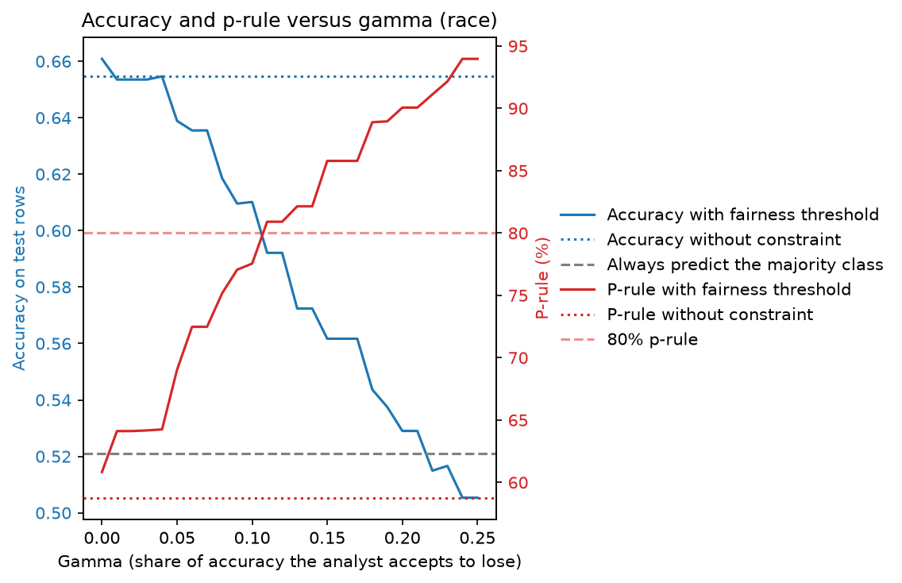

# COMPAS Fairness Diagnostics

Trains a logistic regression on ProPublica's public COMPAS data (7,214 defendants, Broward County, Florida) to predict re-offending within two years, then measures:

1. how much accuracy is lost when the decision threshold is moved to flag African-American and Caucasian defendants at more similar rates (also for sex and age);
2. which features carry information that is both predictive and correlated with race, following [Khodadadian et al., 2021](https://arxiv.org/abs/2106.00772).

Everything is averaged over 20 random splits and compared with baselines. Walkthrough: [notebook](notebooks/fairness_diagnostics.ipynb). Code: `src/compas_fairness`.

## Findings

- No better than the COMPAS score: accuracy 0.662 against 0.656, AUC 0.709 against 0.707. Always guessing the more common outcome scores 0.520.
- The p-rule between races is about 60%, lower than the 76% of the real labels: the model widens the gap.
- Reaching a p-rule of 80% costs 7.7 accuracy points for race, 9.4 for under-25s and 2.3 for sex.
- Removing race changes neither accuracy (0.661 against 0.663) nor the accuracy gap between races (0.0257 against 0.0243). Prior-offense count and age category are the strongest proxies for race.

## Results

Mean (minimum–maximum) over 20 splits (seeds 0–19, 70% train). Test rows only; thresholds are chosen on training rows only; baselines use the same test rows. Race: African-American against Caucasian, 5,915 defendants.

| Method | Accuracy | P-rule | AUC |
|---|---|---|---|
| Always predict the more common outcome | 0.520 (0.495–0.541) | not defined | 0.500 |
| COMPAS decile score ≥ 5 | 0.656 (0.639–0.671) | 60.0 (54.7–63.8) | 0.707 (0.689–0.726) |
| Logistic regression | 0.662 (0.650–0.679) | 60.1 (55.6–63.7) | 0.709 (0.699–0.724) |
| … with fairness threshold, `gamma` = 0.10 | 0.598 (0.570–0.637) | 79.1 (74.8–83.9) | |
| … `gamma` = 0.15 | 0.563 (0.529–0.593) | 85.1 (82.6–90.2) | |
| … `gamma` = 0.20 | 0.532 (0.501–0.559) | 90.4 (88.0–93.8) | |

Sex (female protected; majority class 0.550, COMPAS 0.656): p-rule 65.3 (59.1–73.3) rises to 94.8 (88.6–98.3) at `gamma` = 0.20 while accuracy falls from 0.678 to 0.550. Age under 25 (majority class 0.550, COMPAS 0.656): p-rule 24.7 (16.4–30.8) rises to 79.1 (70.0–97.6) at `gamma` = 0.15 while accuracy falls from 0.636 to 0.590.

Feature analysis (race protected, seed 42): `priors_count` has the largest accuracy and discrimination coefficients (0.043 and 9.8e-6), then `age_cat` (0.022 and 1.2e-5); the other three features are below 0.012 and 4.1e-6.



## Glossary

Columns used from `data/compas-scores-two-years.csv`: `sex`, `age`, `age_cat` (under 25, 25 to 45, over 45), `race`, `priors_count` (prior offenses), `c_charge_degree` (F felony, M misdemeanor), `c_jail_in` and `c_jail_out` (jail dates), `decile_score` (COMPAS score, 1 to 10), `two_year_recid` (1 if the person re-offended within two years). Derived: `length_of_stay` (0 up to 7 days, 1 up to 90, 2 longer) and binned `priors_count` (0 none, 1 one to three, 2 more than three).

| Term | Meaning |
|---|---|
| P-rule | Smaller over larger of two groups' flag rates, in percent; 100% is parity, 80% a common target |
| `gamma` | Share of accuracy the analyst accepts to lose for fairness |
| AUC | Chance that a random person who re-offended scores higher than one who did not; 0.5 is guessing |
| Accuracy gap | Absolute difference in accuracy between Caucasian and African-American defendants |
| Accuracy / discrimination coefficient | What a feature adds to predicting the outcome / how much of that information is shared with race (Shapley values) |

## Limitations

- Two racial groups, one county and period (2013–2014), logistic regression only, and only the p-rule and an accuracy gap as fairness measures.
- Descriptive, not causal. The 20 splits reuse the same defendants, so there are no confidence intervals.
- 235 defendants without jail dates are dropped. They are missing more often for African-American defendants (4.3% against 3.1%) and re-offend far less (17.4% against 47.8%); keeping them with a flag gives a race p-rule of 60.9 instead of 60.1. Why the dates are missing, and whether stay length is known at scoring time, is unverified.
- `age` often differs from screening date minus birth date (unverified why). The raw file holds names and birth dates (public record), which the code never uses.
- Unverified: the CSV was not compared with ProPublica's release; the paper's COMPAS table (5,334 rows, undescribed filter) was not reproduced; the shared-information optimizer matches known answers and a brute-force search but not an independent implementation; count-based information estimates are biased upward for small groups.
- Only the versions below were tested.

## Reproduce

Tested on Python 3.14.7 and 3.12.12 with the exact versions pinned in `requirements.txt`. From the repository root:

```bash
python3 -m venv venv
source venv/bin/activate
pip install -r requirements.txt
pytest
jupyter nbconvert --to notebook --execute --inplace notebooks/fairness_diagnostics.ipynb
```

About four minutes on a fresh clone (install 75–79 s, tests 29 s, notebook 114–125 s). The notebook rewrites itself in place with identical results.

## Repository structure

```
data/          compas-scores-two-years.csv (read-only input)
figures/       accuracy_prule_vs_gamma.png (generated)
notebooks/     fairness_diagnostics.ipynb
src/compas_fairness/   preprocessing, metrics, thresholds, information, seed study, baselines, plots
tests/         known-answer tests
```
